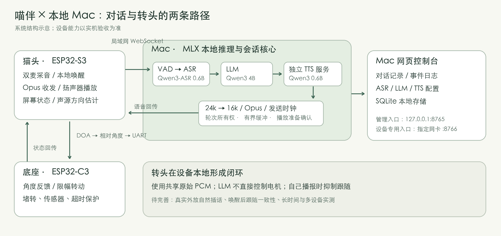

# 喵伴 Miaoban · 声桥 VoiceHub

把ESP32喵伴接到Apple Silicon Mac上的本地ASR、LLM和TTS，提供WebSocket会话、网页控制台，
包含设备端声源定位与底座闭环控制。

**0.1 源码发布。** 包括后端应用、EchoEar 猫头完整源码工程和底座固件源码。
原创代码采用 MIT，派生代码保留原版权声明。模型、依赖缓存和原厂资源另行准备；
这是源码发布，刷写前须核对自己的硬件、分区和资源。

- [技术文章：我把喵伴的“大脑”搬进Mac](docs/ARTICLE.zh-CN.md)
- [验证记录与当前边界](docs/VALIDATION.md)
- [猫头与底座集成说明](firmware/README.md)
- [接口协议](docs/PROTOCOL.md)
- [许可与来源](THIRD_PARTY_NOTICES.md)



## 当前能力

本地ASR → LLM → TTS对话、Opus小智协议适配、通用WebSocket客户端、独立会话/取消、
网页记录和模型配置、设备播放准备握手、有界缓冲和日志。Qwen TTS可单独常驻MLX进程。

实验性 [MQTT＋UDP 接入](docs/MQTT_UDP.md)可选启用，复用同一会话与模型管线。
已完成真实 Broker、软件客户端和喵伴实机对照；两种协议均能正常对话，本轮听感无明显速度差异。

待机听声转头已有实机反馈；底座包含角度反馈、限幅、堵转和超时保护。
唤醒后转头一致性、真实外放自然插话、长时间与多设备运行尚未完整验收。
后台支持取消机制并不等于当前ESP32已完成全双工AEC。

## 目录

```text
realtime_backend/           独立后端、网页、67项测试、启动脚本
firmware/base_controller/  底座ESP32-C3控制器源码
firmware/shared/           串口协议解析
firmware/head/             EchoEar 猫头源码工程、依赖锁和构建配置
firmware/README.md         上游、布局、构建与硬件边界
 tests/                   9个可在主机运行的C++逻辑测试
 docs/                    文章、协议、验证与发布记录
 media/                   架构图（非实拍）
```

## 1. 准备Mac环境

本地模型需要Apple Silicon和可用Metal；测试环境为M4 Max/128GB、Python 3.13。
这不是最低配置声明。HTTP模型接口可以使用其他主机，但本文未逐一验证。

```sh
cd realtime_backend
python3 -m venv .venv
.venv/bin/python -m pip install -r requirements-local.txt
brew install ffmpeg mosquitto
```

仅用HTTP模型服务时安装requirements.txt即可。本包不含模型、VAD权重或用户运行数据。
首次下载是联网准备步骤，运行适配器不会偷偷下载缺失模型。

## 2. 下载模型和VAD

使用安装环境提供的Hugging Face CLI，先阅读各模型仓库的许可和模型卡：

```sh
.venv/bin/hf download mlx-community/Qwen3-ASR-0.6B-8bit
.venv/bin/hf download mlx-community/Qwen3-4B-Instruct-2507-4bit
.venv/bin/hf download mlx-community/Qwen3-TTS-12Hz-0.6B-CustomVoice-8bit
.venv/bin/python scripts/download_vad.py
```

VAD脚本使用Silero官方固定提交，验证SHA256后写入本地models目录；权重不进入源码包。

## 3. 创建配置，预热TTS并启动后台

```sh
.venv/bin/python scripts/configure_local.py --vad-model models/silero_vad.onnx
.venv/bin/python scripts/start_qwen_tts.py
./run.sh
```

配置脚本只创建新配置，存在配置时拒绝覆盖，后续请用网页修改。
打开http://127.0.0.1:8765，在“连接实验室”测试文字和浏览器语音。
浏览器麦克风需由使用者授权。第一次ASR/LLM加载通常更慢。

TTS服务只监听127.0.0.1:8767，默认Serena、24kHz裸PCM。后台连续重采样为16k，
再发给设备。慢启动时先合成整句再播，GPU空闲时流式发送；GPU竞争会增加等待。
服务日志data/qwen-tts.log不记录输入文本和音频。

## 4. 增加ESP32设备入口

管理界面保持回环监听，设备入口绑定Mac在当前局域网中的具体IP。
下面IP只是示例，必须替换成你的Mac地址：

```sh
./run.sh --device-host 192.168.0.10 --device-port 8766
```

设备WebSocket地址：`ws://<MAC_LAN_IP>:8766/xiaozhi/v1/`。
用`python -m voicehub --print-device-token`在本机取得自动生成的设备令牌，
不要把令牌贴进Issue、截图或版本库。对应OTA配置路径为
`http://<MAC_LAN_IP>:8766/xiaozhi/ota/<DEVICE_TOKEN>/`。

设备Wi-Fi、WebSocket和OTA配置需按你的固件配置机制写入。不要使用其他机器的NVS。
阅读firmware/README.md后再处理设备；本包没有自动擦写、原厂资源或一键刷机脚本。

## 5. 修改模型

网页“模型配置 → 语音合成”选择兼容HTTP API：

| 字段 | 本地Qwen值 |
|---|---|
| 模型ID | mlx-community/Qwen3-TTS-12Hz-0.6B-CustomVoice-8bit |
| API Base URL | http://127.0.0.1:8767/v1 |
| 音色 | Serena |
| PCM采样率 | 24000 |
| 密钥环境变量 | VOICE_TTS_KEY（本地服务无需真实密钥） |

更改只对新连接生效。Qwen服务还支持其预设音色列表，见`GET /health`。
也可以切回macOS原生Tingting。外部服务必须返回单声道s16le裸PCM，不能把WAV/MP3当PCM。

## 验证

```sh
cd realtime_backend
.venv/bin/python -m unittest discover -s tests -v
```

主机C++逻辑测试从仓库根目录运行：

```sh
python3 scripts/test_firmware_logic.py
```

这两组测试不刷写设备。硬件构建与物理效果需要另外验收。
本次发布的测试结果、采样性能和未完事项见docs/VALIDATION.md。
